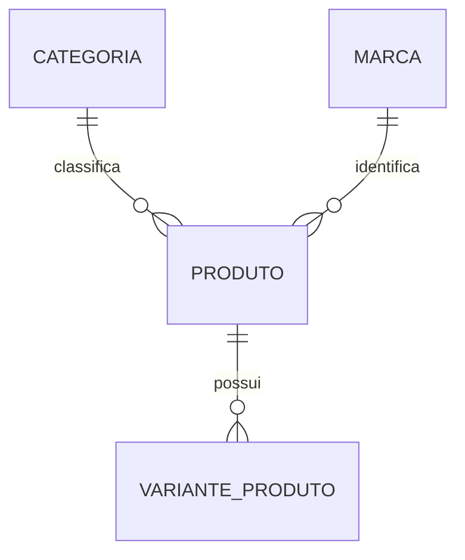

# Modelo do catálogo

O catálogo é a referência comum aos fornecedores. Uma oferta futura deverá apontar para o ID de uma variante já cadastrada, sem criar uma comparação baseada apenas no título livre informado pelo fornecedor.

## Identidade

- Categoria e marca têm nomes únicos após normalização de maiúsculas e espaços. A apresentação preserva maiúsculas e acentos.
- Produto pertence a uma categoria e uma marca. O modelo completo normalizado é único dentro da marca, mesmo que o título ou a categoria sejam diferentes. Use o modelo específico do fabricante, por exemplo `iPhone 16 Pro Max`, em vez de nomes genéricos como `Pro`.
- Variante é identificada pela combinação de produto, armazenamento em GB, cor, condição e atributos adicionais. A restrição `UNIQUE NULLS NOT DISTINCT` impede duplicatas mesmo com armazenamento ou cor ausentes.
- Condições permitidas: `NOVO`, `USADO` e `RECONDICIONADO`.
- Armazenamento, quando presente, deve ser inteiro positivo. Cor, quando presente, não pode ser vazia.
- Cor e atributos são normalizados para minúsculas e espaços simples. Acentos são preservados: não há busca aproximada, remoção de acentos ou inferência de sinônimos.
- Campos ausentes e campos informados são diferentes: armazenamento nulo não equivale a 256 GB. As flags `exigeArmazenamento`, `exigeCor` e o conjunto `atributosObrigatorios` definem quais características devem estar presentes antes de criar ou aprovar uma oferta. Essas exigências também são conferidas na elegibilidade pública.

Assim, iPhone 16 Pro Max de 256 GB e 512 GB são variantes distintas; novo e usado também. A ordem de chaves no JSONB não muda a identidade da variante.

## Atributos adicionais

Mapa textual com até 8 pares. Chaves usam letras ASCII minúsculas, números e sublinhado, começando por letra, com até 32 caracteres. Exemplos: `ram_gb`, `tela_polegadas` e `acabamento`.

Valores têm até 64 caracteres e são normalizados. Não é permitido repetir `cor`, `condicao` ou `armazenamento_gb` no mapa, nem informar duas chaves que fiquem iguais após normalização. O JSONB é limitado a 1400 bytes para manter a restrição de unicidade por valor dentro do limite de indexação; o domínio também limita o tamanho da representação normalizada.

O fornecedor consulta variantes e suas pendências em `/api/fornecedor/catalogo/variantes`. Criar ou aprovar uma oferta exige variante completa. A gestão do catálogo global permanece prevista na etapa 10; o fornecedor não modifica características compartilhadas por outras empresas.

## Integridade e persistência

As entidades ficam em `backend/src/main/java/br/com/comparapreco/catalogo/entity`, regras de normalização em `catalogo/domain` e acesso a dados em `catalogo/repository`. Associações JPA são lazy e não usam remoção em cascata. Chaves estrangeiras impedem excluir categorias, marcas ou produtos ainda referenciados.

IDs são UUIDs. Datas de criação usam `Instant` na aplicação e `timestamptz` no PostgreSQL. As migrações Flyway controlam a estrutura; Hibernate apenas a valida. As entidades não são contratos de resposta HTTP.

## Demonstração e validação

O perfil `demo` adiciona a localização `db/demo` às migrações. O script repetível contém registros fictícios de catálogo, sem preços ou fornecedores. Os IDs são estáveis e a carga não atualiza dados existentes. Use um banco exclusivo para demonstração: nomes ou modelos já cadastrados com outros IDs podem entrar em conflito com as restrições do catálogo.

Os testes de persistência usam um PostgreSQL temporário com Testcontainers, independente do banco local. Cada cenário de catálogo é transacional e revertido. A carga demo é executada duas vezes dentro de uma transação de teste para verificar a reaplicação sem duplicação. O perfil padrão é verificado sem os registros demo.
